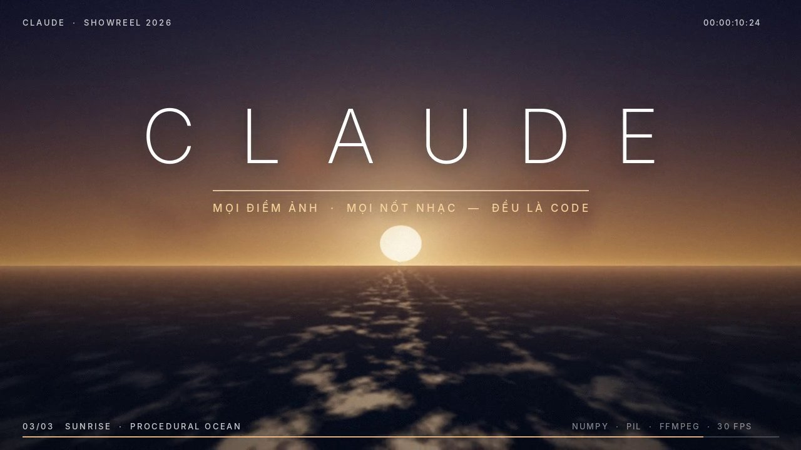
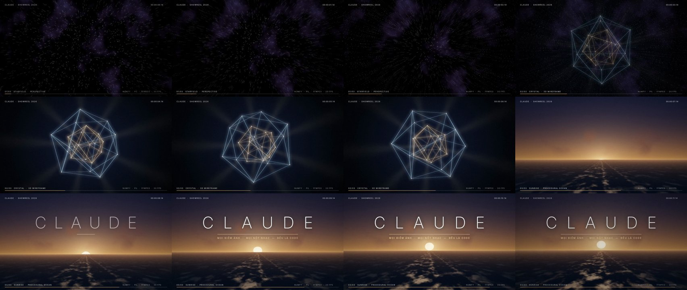

<div align="center">

# 🎬 showreel-from-code

**Video 12 giây mà mọi điểm ảnh, mọi nốt nhạc đều là code.**

Không model sinh ảnh, không footage, không nhạc có sẵn — chỉ có `numpy` + `pillow` + `ffmpeg`.




</div>

---

## 🎞️ Có gì trong video

| Thời gian | Cảnh | Kỹ thuật |
|---|---|---|
| 0.0 – 3.5s | **01 · Starfield** — bay xuyên 2.600 ngôi sao + tinh vân | Chiếu phối cảnh 3D, vệt chuyển động, bloom |
| 3.3 – 6.9s | **02 · Crystal** — 2 khối 20 mặt xoay ngược nhau | Wireframe 3D, xoay ma trận, glow, tia sáng |
| 6.5 – 12s | **03 · Sunrise** — bình minh trên biển + title | Trời gradient, mặt trời, mây fBm, sóng phối cảnh, lấp lánh |

**Overlay HUD:** timecode chạy, số cảnh, thanh tiến độ.

**🎵 Nhạc** (`music.py`): pad Am → F → C, whoosh lúc chuyển cảnh, sub-hit khi title hiện, chuông pentatonic, tiếng sóng và reverb — tất cả tổng hợp từ sóng sin và noise.



---

## 🚀 Chạy

```bash
# Linux / VPS / homelab
sudo apt install -y ffmpeg python3-pip
pip install -r requirements.txt
bash run.sh            # → out/showreel.mp4 + out/contact-sheet.jpg
```

```powershell
# Windows
winget install ffmpeg
pip install -r requirements.txt
.\run.ps1
```

⏱️ Render khoảng **2,5 phút trên 2 nhân CPU** cho 360 frame 1280×720. Font Inter (OFL) đã kèm sẵn trong `fonts/`, không cần cài.

### Lệnh lẻ

```bash
python3 music.py                          # out/music.wav
python3 render.py preview 2 5 10.8        # chỉ render vài frame PNG để duyệt (vài giây)
python3 render.py video out/showreel.mp4  # render đầy đủ
python3 check.py out/showreel.mp4         # PASS/FAIL + contact sheet
```

---

## 🏗️ Cấu trúc

```
showreel-from-code/
├── render.py      # renderer: 3 cảnh + overlay + compositing, pipe frame thô vào ffmpeg
├── music.py       # nhạc nền tổng hợp bằng numpy → out/music.wav
├── check.py       # QA gate: stream, keyframe, frame đen, nháy sáng + contact sheet (exit 1 nếu lỗi)
├── run.sh / run.ps1   # cả pipeline: nhạc → preview → render → check
├── fonts/         # Inter ExtraLight + Medium (hỗ trợ tiếng Việt) + license
├── docs/          # poster + contact sheet
└── .claude/skills/code-showreel/   # skill cho Claude Code dựng video kiểu này đúng quy trình
```

---

## 🎨 Tùy biến nhanh

| Muốn đổi | Sửa ở đâu |
|---|---|
| **Chữ** | `TITLE`, `SUBTITLE`, `HUD_BRAND`, `HUD_STACK` đầu `render.py` |
| **Thời lượng / độ phân giải** | `W, H, FPS, DUR` — đổi `DUR` thì sửa luôn mốc cảnh trong `frame()` và `DUR` trong `music.py` |
| **Hợp âm** | Các dòng `pad([...])` trong `music.py` (số MIDI, 60 = C4) |
| **Thêm cảnh** | Viết `shot_xxx(u, t)` trả mảng `H×W×3` float (0..1+), chèn vào `frame()` với crossfade 0.4s |

---

## 🧠 Quy trình: duyệt trước, xuất sau

Bài học rút ra khi dựng video bằng AI:

1. **Duyệt 1 khung trước khi xuất.** `render.py preview` ra PNG trong vài giây. Đừng xuất cả video chỉ để xem một cảnh — có lần mất 4–5 tiếng.
2. **Keyframe mỗi giây** (`-g FPS -keyint_min FPS`). Thiếu keyframe thì render có thể chạy ~10 phút rồi hỏng mà không báo lý do.
3. **Để máy tự kiểm, rồi xem bằng mắt.** `check.py` bắt lỗi kỹ thuật, contact sheet là để người xem. Tự kiểm là để đỡ việc, không phải để khỏi xem.
4. **Số nào lên màn hình cũng phải có nguồn.** Trí nhớ của AI có thể đã cũ.
5. **Đưa phong cách cụ thể.** Để AI tự chọn thì nó lấy mặc định (chữ trắng nền gradient tím).

**Ba lỗi bắt được ở bước duyệt khung khi làm repo này:**

| Lỗi | Cách sửa |
|---|---|
| Mặt trời mọc đè lên title | Hạ quỹ đạo mặt trời, đẩy title lên |
| Mặt biển ra lưới chấm đều tăm tắp | Thay sóng sin bằng texture fBm lấy mẫu theo phối cảnh, kéo dài theo chiều ngang |
| Đường nối giữa texture | Mirror-tile texture thành 2048×2048 liền mạch |

---

## 📝 Giấy phép

- Mã nguồn: **MIT** — xem [LICENSE](LICENSE).
- Font [Inter](https://rsms.me/inter/) © The Inter Project Authors, SIL Open Font License — xem `fonts/LICENSE-Inter.txt`.
